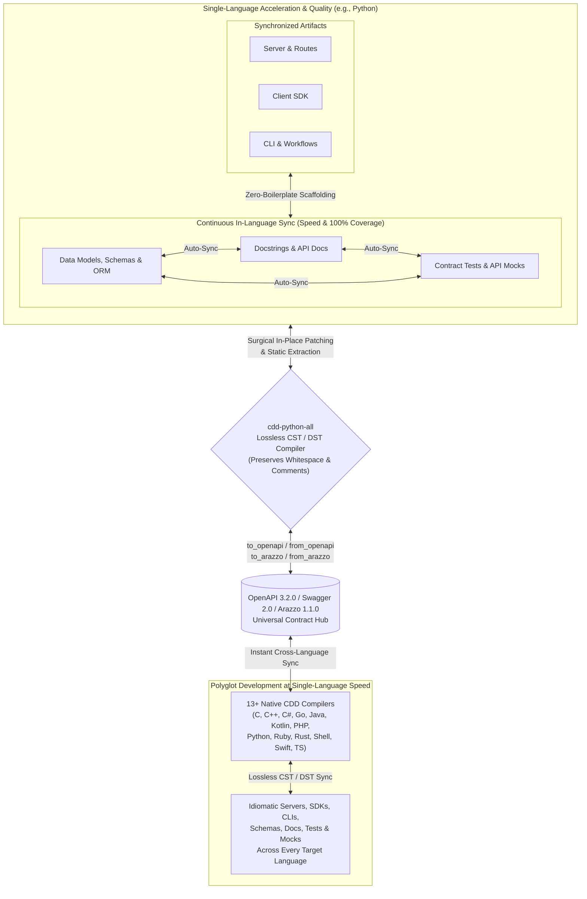

cdd-python-all: Python ⇄ OpenAPI
================================

[](https://opensource.org/licenses/Apache-2.0)
[](https://offscale.io/wasm_web_demo)
[](https://github.com/offscale/cdd-python-all/actions)
[](#)
[](#)

**cdd-python-all** compiles **[OpenAPI](https://spec.openapis.org/oas/latest.html) / [Swagger](https://spec.openapis.org/oas/v2.0.html) / [Arazzo](https://spec.openapis.org/arazzo/latest.html)** to and from **Python** (servers, client SDKs, CLIs, database schemas, tests, mocks, and docs), updating your existing code in-place without overwriting your edits.

**Compiler Driven Development (CDD)** is a software engineering methodology that uses a suite of standalone, lossless compilers to synchronize API specifications, server implementations, client SDKs, command-line tooling, workflow orchestrators, tests, and documentation.

Unlike traditional code generators that treat outputs as disposable or read-only, Compiler Driven Development provides a **complete, standalone compiler** (exposed as both a CLI and a programmatic SDK) written natively in each supported language. Where conventional compilers rely solely on an Abstract Syntax Tree (AST) that discards formatting and comments, CDD compilers operate on a **Concrete Syntax Tree (CST)** or **Decorated Syntax Tree (DST)**. This guarantees **lossless conversion**—preserving exact whitespace, indentation, inline comments, block comments, and docstrings—allowing true bidirectional synchronization between hand-edited `Python` source code and [OpenAPI 3.2.0](https://spec.openapis.org/oas/v3.2.0.html), [Swagger 2.0](https://spec.openapis.org/oas/v2.0.html), and [Arazzo 1.1.0](https://spec.openapis.org/arazzo/v1.1.0.html) specifications.

---

## Why Compiler Driven Development?

By replacing one-way templates and manual boilerplate with lossless CST/DST compilers, Compiler Driven Development transforms the engineering lifecycle across four dimensions:

- **Development Speed**: Eliminate manual boilerplate across servers, client SDKs, CLIs, database models, workflow runners, and mock servers. Start from an [OpenAPI](https://spec.openapis.org/oas/latest.html) or [Arazzo](https://spec.openapis.org/arazzo/latest.html) specification to scaffold an entire installable project (complete with package manifests and CI workflows), or write code first in `Python` and extract the specification automatically. When requirements change, update whichever representation is most convenient and synchronize the rest immediately.
- **Development Consistency**: Every data model, route handler, CLI flag, ORM entity, workflow step, and API contract is derived from and validated against the same semantic representation. Architectural drift between backend routes, frontend clients, and published specifications becomes structurally impossible.
- **Development Quality**: Keeping tests and documentation in lockstep with implementation code is automated rather than an afterthought. Because the compiler parses and emits docstrings, type signatures, API mocks, and contract test suites alongside your business logic, maintaining **100% documentation coverage and 100% test coverage** becomes a natural byproduct of compilation rather than a manual chore.
- **Polyglot Development**: Seamlessly bridge **13+ programming languages** (C, C++, C#, Go, Java, Kotlin, PHP, Python, Ruby, Rust, POSIX Shell, Swift, and TypeScript) to and from [OpenAPI](https://spec.openapis.org/oas/latest.html) and [Arazzo](https://spec.openapis.org/arazzo/latest.html) specifications. Any codebase in any supported language can be reverse-compiled into OpenAPI/Arazzo and immediately compiled forward into idiomatic, human-editable code across every other language in the suite. And being an open-source methodology—rather than a proprietary trade secret—new languages can be added by implementing new compilers that follow the CDD approach (see [cdd-spec-conformance](https://github.com/SamuelMarks/cdd-spec-conformance) for tooling to facilitate).

---

## The Standalone Compiler Architecture and Lossless Conversion

Traditional code generation tools rely on destructive templating: if you regenerate your project from an updated specification, your custom implementation logic, formatting, and comments are overwritten.

Each Compiler Driven Development toolchain is written natively in its target language, compiles both to native binaries and to **WebAssembly (WASM/WASI)**, and implements a full lexer, parser, semantic differ, and code emitter backed by Concrete Syntax Tree (CST) and Decorated Syntax Tree (DST) representations:

- **Beyond AST to CST/DST**: A standard Abstract Syntax Tree (AST) captures program semantics while stripping away "trivia" (whitespace, blank lines, and comments). By pairing structural AST semantics with a Concrete Syntax Tree (CST) or Decorated Syntax Tree (DST) that attaches trivia and structured documentation directly to syntax nodes, the compiler preserves 100% of your source formatting and comments.
- **Zero-Destruction Guarantee**: Every part of the generated codebase is designed to be edited by humans. You can open generated routing files, data models, database entities, workflow runners, tests, and CLI commands, format them to your preferences, add inline comments, and inject custom business logic.
- **When your specification changes**: The CDD compiler parses your existing source files into a CST/DST, computes a semantic diff against the updated [OpenAPI](https://spec.openapis.org/oas/latest.html) or [Arazzo](https://spec.openapis.org/arazzo/latest.html) specification, and surgically patches in new endpoints, workflows, parameters, or fields without disturbing your custom logic, comments, or whitespace.
- **When your codebase changes**: The compiler statically analyzes your updated source code, routes, workflows, tests, and docstrings—without unsafe dynamic code execution or reflection—to extract a 100% compliant, authoritative [OpenAPI](https://spec.openapis.org/oas/latest.html) or [Arazzo](https://spec.openapis.org/arazzo/latest.html) specification.

---

## The Bidirectional Synchronization Loop



The Compiler Driven Development lifecycle delivers compounding returns in both single-language and polyglot environments:
1. **Single-Language Speed**: Edit whichever artifact is most convenient—models/schemas, route handlers, docstrings, or tests—and let `cdd-python-all` surgically synchronize the rest in-place without overwriting your custom logic, comments, or whitespace.
2. **Single-Language Quality**: Because schemas, documentation, contract tests, and mocks are continuously cross-compiled rather than manually maintained, **100% doc coverage and 100% test coverage** are enforced automatically on every sync.
3. **Polyglot Development at Single-Language Speed**: Extracting an authoritative [OpenAPI](https://spec.openapis.org/oas/latest.html) or [Arazzo](https://spec.openapis.org/arazzo/latest.html) contract from one language immediately drives lossless forward-compilation across all 13+ supported languages—making multi-language SDK, CLI, and service maintenance just as fast as working in a single codebase.

---

## Core Capabilities Shared Across All CDD Compilers

Every `cdd-*` repository in the suite implements the same foundational feature set:

- **Bidirectional OpenAPI 3.2.0 & Swagger 2.0 Compilation**:
  - `from_openapi`: Generate idiomatic `Python` Client SDKs (`to_sdk`), Client CLIs (`to_sdk_cli`), and Server stubs/routers (`to_server`) from a single specification (`-i`) or a batch directory of specifications (`--input-dir`). Automatically upgrades legacy Swagger 2.0 and OpenAPI 3.0/3.1 specifications to OpenAPI 3.2.0.
  - `to_openapi`: Statically parse existing `Python` source files or directories to extract a compliant OpenAPI 3.2.0 specification.
- **Bidirectional Arazzo 1.1.0 Workflow Orchestration**:
  - `from_arazzo`: Compile multi-step [Arazzo 1.1.0](https://spec.openapis.org/arazzo/v1.1.0.html) workflow specifications (including runtime expressions, step DAGs, criterion evaluations, and failure/success actions) into `Python` SDK workflow orchestrators (`to_sdk`), CLI workflow runners (`to_sdk_cli`), and Server/E2E workflow test suites (`to_server`).
  - `to_arazzo`: Reverse-parse `Python` workflow orchestrators, CLI scripts, or E2E test suites back into an authoritative Arazzo 1.1.0 document.
- **In-Place Codebase Synchronization (`sync`)**:
  - Synchronize data models, ORM schemas, route handlers, docstrings, contract tests, mocks, and specifications in-place using lossless CST/DST patching.
- **Documentation Code-Snippet Generation (`to_docs_json`)**:
  - Emit a structured JSON documentation payload containing idiomatic `Python` request/workflow code snippets for every operation in an OpenAPI specification (with `--no-imports` and `--no-wrapping` options for embedding in documentation portals).
- **Composable Contract Tests, Mocks, CI, and Package Scaffolding**:
  - By default, `from_openapi` and `from_arazzo` scaffold complete, installable `Python` packages and `.github/workflows/ci.yml` pipelines (configurable via `--no-installable-package` and `--no-github-actions`), and generate contract test suites and API mocks/fakes via `--tests`.
- **Model Context Protocol (`mcp`) & JSON-RPC (`serve_json_rpc`)**:
  - Run `cdd-python-all mcp` to expose the compiler over stdio as an [MCP](https://modelcontextprotocol.io/) server for AI assistants and IDEs, or pass `--mcp` during generation to emit MCP tool/resource adapters directly inside generated SDKs and servers.
  - Run `cdd-python-all serve_json_rpc` to expose the compiler's full API over JSON-RPC 2.0 (`--port`, `--listen`).
- **Native CLI, Programmatic SDK, and WebAssembly (WASM/WASI)**:
  - Use `cdd-python-all` from the command line, import its programmatic SDK directly into `Python` applications, or run it in the browser and WASI runtimes via its WebAssembly build (see [WASM.md](WASM.md)).

---

## The Global Polyglot Ecosystem

Every supported language operates on the same core Compiler Driven Development principles and is powered by a dedicated, native compiler tailored to that language's syntax tree, idioms, and package manager.

All implementations expose a standardized command-line interface (`cdd-python-all <subcommand>`) and programmatic SDK.

| Repository | Language | Targets (`to_sdk`; `to_sdk_cli`; `to_server`) | Special Features Beyond Common Subset | Standards | CI Status |
|---|---|---|---|---|---|
| [`cdd-c`](https://github.com/SamuelMarks/cdd-c) | C (C89) | Client; Client CLI; Server | 42-Language FFI Generator (`bind`); GNU-to-C89 AST Lowering; Safe CRT & Memory Security Auditor; `c-orm` Migrations | [Arazzo 1.1.0](https://spec.openapis.org/arazzo/v1.1.0.html); [Swagger 2.0](https://spec.openapis.org/oas/v2.0.html); [OpenAPI 3.2.0](https://spec.openapis.org/oas/v3.2.0.html); [MCP](https://modelcontextprotocol.io/) | [](https://github.com/SamuelMarks/cdd-c/actions/workflows/ci.yml) |
| [`cdd-cpp`](https://github.com/SamuelMarks/cdd-cpp) | C++ | Client; Client CLI; Server | [Google Discovery](https://developers.google.com/discovery) (`from_google_discovery`); PostgreSQL `libpq` ORM & Faker Support | [Google Discovery](https://developers.google.com/discovery); [Arazzo 1.1.0](https://spec.openapis.org/arazzo/v1.1.0.html); [Swagger 2.0](https://spec.openapis.org/oas/v2.0.html); [OpenAPI 3.2.0](https://spec.openapis.org/oas/v3.2.0.html); [MCP](https://modelcontextprotocol.io/) | [](https://github.com/SamuelMarks/cdd-cpp/actions/workflows/ci.yml) |
| [`cdd-csharp`](https://github.com/SamuelMarks/cdd-csharp) | C# | Client; Client CLI; Server | CLR & Roslyn CST/DST Trivia-Preserving Sync; Entity Framework & Minimal API Targets | [Arazzo 1.1.0](https://spec.openapis.org/arazzo/v1.1.0.html); [Swagger 2.0](https://spec.openapis.org/oas/v2.0.html); [OpenAPI 3.2.0](https://spec.openapis.org/oas/v3.2.0.html); [MCP](https://modelcontextprotocol.io/) | [](https://github.com/SamuelMarks/cdd-csharp/actions/workflows/ci.yml) |
| [`cdd-go`](https://github.com/SamuelMarks/cdd-go) | Go | Client; Client CLI; Server | Go `dst`/`ast` Surgical Patching; Multi-Source Truth Sync (`code` ⇄ `openapi`) | [Arazzo 1.1.0](https://spec.openapis.org/arazzo/v1.1.0.html); [Swagger 2.0](https://spec.openapis.org/oas/v2.0.html); [OpenAPI 3.2.0](https://spec.openapis.org/oas/v3.2.0.html); [MCP](https://modelcontextprotocol.io/) | [](https://github.com/SamuelMarks/cdd-go/actions/workflows/ci.yml) |
| [`cdd-java`](https://github.com/SamuelMarks/cdd-java) | Java | Client; Client CLI; Server | JavaParser CST Lexical Preservation; WASI JSON-RPC Mode; In-Memory Compiler Pipeline | [Arazzo 1.1.0](https://spec.openapis.org/arazzo/v1.1.0.html); [Swagger 2.0](https://spec.openapis.org/oas/v2.0.html); [OpenAPI 3.2.0](https://spec.openapis.org/oas/v3.2.0.html); [MCP](https://modelcontextprotocol.io/) | [](https://github.com/SamuelMarks/cdd-java/actions/workflows/ci.yml) |
| [`cdd-kotlin`](https://github.com/offscale/cdd-kotlin) | Kotlin (Ktor Multiplatform) | Client; Client CLI; Server | Multiplatform Auto-Admin UI; Ephemeral & Seeded Mock Server Modes; Webhook Triggers | [Arazzo 1.1.0](https://spec.openapis.org/arazzo/v1.1.0.html); [Swagger 2.0](https://spec.openapis.org/oas/v2.0.html); [OpenAPI 3.2.0](https://spec.openapis.org/oas/v3.2.0.html); [MCP](https://modelcontextprotocol.io/) | [](https://github.com/offscale/cdd-kotlin/actions/workflows/ci.yml) |
| [`cdd-php`](https://github.com/SamuelMarks/cdd-php) | PHP | Client; Client CLI; Server | Multi-Tiered DAO (`StubDao` / `ConcreteDao`); Ephemeral & Faker-Seeded SQLite Server Modes | [Arazzo 1.1.0](https://spec.openapis.org/arazzo/v1.1.0.html); [Swagger 2.0](https://spec.openapis.org/oas/v2.0.html); [OpenAPI 3.2.0](https://spec.openapis.org/oas/v3.2.0.html); [MCP](https://modelcontextprotocol.io/) | [](https://github.com/SamuelMarks/cdd-php/actions/workflows/ci.yml) |
| [`cdd-python`](https://github.com/offscale/cdd-python) | Python | N/A (server building blocks) | CLI ⇄ SQLAlchemy ⇄ Pydantic ⇄ Docs ⇄ JSON Schema | N/A | [](https://github.com/offscale/cdd-python/actions) |
| [`cdd-python-all`](https://github.com/offscale/cdd-python-all) | Python | Client; Client CLI; Server | `LibCST` Lossless Sync; Multi-Truth Sync (`class`, `sqlalchemy`, `function`, `openapi`); FastAPI + SQLAlchemy | [Arazzo 1.1.0](https://spec.openapis.org/arazzo/v1.1.0.html); [Swagger 2.0](https://spec.openapis.org/oas/v2.0.html); [OpenAPI 3.2.0](https://spec.openapis.org/oas/v3.2.0.html); [MCP](https://modelcontextprotocol.io/) | [](https://github.com/offscale/cdd-python-all/actions/workflows/ci.yml) |
| [`cdd-ruby`](https://github.com/SamuelMarks/cdd-ruby) | Ruby | Client; Client CLI; Server | ActiveRecord Sync (`class`, `activerecord`, `function`); Ephemeral & Seeded Server Generation | [Arazzo 1.1.0](https://spec.openapis.org/arazzo/v1.1.0.html); [Swagger 2.0](https://spec.openapis.org/oas/v2.0.html); [OpenAPI 3.2.0](https://spec.openapis.org/oas/v3.2.0.html); [MCP](https://modelcontextprotocol.io/) | [](https://github.com/SamuelMarks/cdd-ruby/actions/workflows/ci.yml) |
| [`cdd-rust`](https://github.com/SamuelMarks/cdd-rust) | Rust | Client; Client CLI; Server | Actix-Web, Axum & Reqwest Targets; Diesel Schema Sync; Standalone `schema-gen`, `scaffold` & `test-gen` | [Arazzo 1.1.0](https://spec.openapis.org/arazzo/v1.1.0.html); [Swagger 2.0](https://spec.openapis.org/oas/v2.0.html); [OpenAPI 3.2.0](https://spec.openapis.org/oas/v3.2.0.html); [MCP](https://modelcontextprotocol.io/) | [](https://github.com/SamuelMarks/cdd-rust/actions/workflows/ci.yml) |
| [`cdd-sh`](https://github.com/SamuelMarks/cdd-sh) | Shell (`/bin/sh`) | Client; Client CLI; Server | Zero-Dependency Embedded `sh`/`jq`/`awk` Cross-Platform Binary; Direct AST `parse` & `emit` Subcommands | [Arazzo 1.1.0](https://spec.openapis.org/arazzo/v1.1.0.html); [Swagger 2.0](https://spec.openapis.org/oas/v2.0.html); [OpenAPI 3.2.0](https://spec.openapis.org/oas/v3.2.0.html); [MCP](https://modelcontextprotocol.io/) | [](https://github.com/SamuelMarks/cdd-sh/actions/workflows/ci.yml) |
| [`cdd-swift`](https://github.com/SamuelMarks/cdd-swift) | Swift | Client; Client CLI; Server | `SwiftSyntax` Lossless Merging (`merge_swift`); Vapor + Fluent ORM Scaffolding; `sync_arazzo` | [Arazzo 1.1.0](https://spec.openapis.org/arazzo/v1.1.0.html); [Swagger 2.0](https://spec.openapis.org/oas/v2.0.html); [OpenAPI 3.2.0](https://spec.openapis.org/oas/v3.2.0.html); [MCP](https://modelcontextprotocol.io/) | [](https://github.com/SamuelMarks/cdd-swift/actions/workflows/ci.yml) |
| [`cdd-ts`](https://github.com/offscale/cdd-ts) | TypeScript | Client; Client CLI; Server | Auto-Admin UI; Angular, React, Vue, Vanilla; Fetch, Axios, Node; Express, Bun, Deno; TypeORM Sync | [Arazzo 1.1.0](https://spec.openapis.org/arazzo/v1.1.0.html); [Swagger 2.0](https://spec.openapis.org/oas/v2.0.html); [OpenAPI 3.2.0](https://spec.openapis.org/oas/v3.2.0.html); [MCP](https://modelcontextprotocol.io/) | [](https://github.com/offscale/cdd-ts/actions/workflows/ci.yml) |

---

## Programmatic SDK & CLI Quickstart

Every `cdd-*` toolchain can be invoked either as a standalone CLI binary or imported as a native `Python` library.

### Minimal CLI Usage

```sh
# Print help and version
cdd-python-all --help
cdd-python-all --version

# Generate a Python Client SDK, Client CLI, or Server from an OpenAPI spec
cdd-python-all from_openapi to_sdk -i spec.json -o ./sdk --tests
cdd-python-all from_openapi to_sdk_cli -i spec.json -o ./cli --tests
cdd-python-all from_openapi to_server -i spec.json -o ./server --tests

# Extract an OpenAPI 3.2.0 spec from existing Python source code
cdd-python-all to_openapi -i ./src -o openapi.json

# Generate and extract Arazzo 1.1.0 multi-step workflows
cdd-python-all from_arazzo to_sdk -i workflow.arazzo.json -o ./workflows --tests
cdd-python-all from_arazzo to_sdk_cli -i workflow.arazzo.json -o ./workflow-cli --tests
cdd-python-all from_arazzo to_server -i workflow.arazzo.json -o ./workflow-server --tests
cdd-python-all to_arazzo -i ./workflows -o extracted.arazzo.json

# Synchronize codebase models, routes, tests, docs, and OpenAPI in-place
cdd-python-all sync -i ./src -o openapi.json

# Generate documentation-ready Python code snippets JSON for an OpenAPI spec
cdd-python-all to_docs_json --no-imports --no-wrapping -i spec.json -o docs.json

# Run as a Model Context Protocol (MCP) server over stdio or JSON-RPC 2.0 server
cdd-python-all mcp
cdd-python-all serve_json_rpc --port 8080 --listen 127.0.0.1
```

### Programmatic SDK Example

```python
from openapi_client import (
    ClientGenerator,
    extract_from_code,
    generate_docs_json,
    generate_from_openapi,
    generate_to_openapi,
    run_sync,
)
from openapi_client.openapi.parse import parse_openapi_json
from openapi_client.sdk import generate_from_arazzo, generate_to_arazzo

# 1. Generate a Python Client SDK, Client CLI, or FastAPI + SQLAlchemy Server
generate_from_openapi(
    input_path="spec.json",
    output_dir="./sdk",
    tests=True,
    subcommand="to_sdk",
)

# 2. Extract an OpenAPI 3.2.0 specification from existing Python code
generate_to_openapi(input_dir="./sdk", output_path="openapi.json")

# 3. Compile and extract Arazzo 1.1.0 multi-step workflows
generate_from_arazzo(
    input_path="workflow.arazzo.json",
    output_dir="./workflows",
    tests=True,
    subcommand="to_sdk",
)
generate_to_arazzo(input_dir="./workflows", output_path="extracted.arazzo.json")

# 4. Synchronize a project directory in-place using a designated source of truth
run_sync(input_dir="./sdk", truth="openapi")

# 5. Emit documentation code snippets JSON or invoke the CST generator in-memory
generate_docs_json(
    input_path="spec.json",
    no_imports=True,
    no_wrapping=True,
    output_path="docs.json",
)
spec = parse_openapi_json(open("spec.json", encoding="utf-8").read())
client_source_code = ClientGenerator(spec).generate_code()
roundtrip_spec = extract_from_code(client_source_code)
```

### Installation & Development

All `cdd-*` repositories support both native language build tools and a standardized cross-platform `Makefile` / `make.bat` interface (`deps`, `build`, `test`):

```sh
make deps
make build
make test
# or on Windows:
.\make.bat deps
.\make.bat build
.\make.bat test
```

For native Python development using `uv` or `pip` (`Makefile` also exposes `make install_deps`, `make docs`, and `make build_wasm`):

```sh
# Create a virtual environment and install package with dev dependencies
uv venv
uv pip install -e ".[dev]"
# or with standard pip:
python3 -m venv .venv && .venv/bin/pip install -e ".[dev]"

# Build wheel distribution into dist/
uv build --wheel --out-dir dist

# Run lint, formatting, 100% docstring coverage, and 100% test coverage checks
uv run ruff check .
uv run ruff format --check .
uv run python scripts/doc_coverage.py
uv run pytest --cov=src/openapi_client --cov-fail-under=100
```

> **Further Documentation**:
> - [**ARCHITECTURE.md**](ARCHITECTURE.md) — Compiler pipeline (Lexer → CST/DST/AST → Semantic Diff → Emitter).
> - [**COMPLIANCE.md**](COMPLIANCE.md) — Swagger 2.0, OpenAPI 3.2.0, Arazzo 1.1.0, and MCP support matrices.
> - [**USAGE.md**](USAGE.md) — Detailed CLI, SDK, ORM, and roundtrip usage guide.
> - [**DEVELOPING.md**](DEVELOPING.md) — Local development, linting, testing, and coverage guide.
> - [**WASM.md**](WASM.md) — WebAssembly / WASI build and browser/Node.js execution instructions.
> - [**PUBLISH.md**](PUBLISH.md) — Package publishing and release workflow.

---

## Universal CLI Toolchain

Once you learn the Compiler Driven Development CLI in one language, you can use the exact same commands, flags, and environment variables across the entire polyglot stack.

### Common Arguments & Environment Variables

| Flag | Short | Environment Variable | Description |
|---|---|---|---|
| `--help` | `-h` | — | Print help information for the CLI or subcommand. |
| `--version` | `-v` / `-V` | — | Print version information. |
| `--input <path>` | `-i` / `-f` | `CDD_INPUT` | Path or URL to the input OpenAPI/Arazzo spec or source file/directory. |
| `--input-dir <dir>` | `-d` | `CDD_INPUT_DIR` | Directory containing multiple OpenAPI/Arazzo specifications for batch generation. |
| `--output <path>` | `-o` | `CDD_OUTPUT` | Destination file or directory path for generated code or extracted specifications. |
| `--tests` | `-t` | `CDD_TESTS` | Generate composable contract/integration tests and API mocks alongside code. |
| `--mcp` | `-m` | `CDD_MCP` | Generate Model Context Protocol (MCP) server and client adapters. |
| `--no-github-actions` | — | `CDD_NO_GITHUB_ACTIONS` | Do not generate `.github/workflows/ci.yml` scaffolding in target output. |
| `--no-installable-package` | — | `CDD_NO_INSTALLABLE_PACKAGE` | Do not generate package manifest/build files in target output. |
| `--no-imports` | — | `CDD_NO_IMPORTS` | (`to_docs_json`) Omit import/include statements from generated documentation snippets. |
| `--no-wrapping` | — | `CDD_NO_WRAPPING` | (`to_docs_json`) Omit boilerplate wrapper functions/classes from documentation snippets. |
| `--port <port>` | `-p` | `CDD_PORT` | (`serve_json_rpc`) TCP port to listen on (default: `8080`). |
| `--listen <addr>` | `-l` | `CDD_LISTEN` | (`serve_json_rpc`) Host/IP address to bind to (default: `127.0.0.1`). |
| `--truth <source>` | `-t` | `CDD_TRUTH` | (`sync`) Designate the single source of truth when synchronizing. |

### Core Subcommands

- **`from_openapi [to_sdk | to_sdk_cli | to_server]`**: Compile an OpenAPI 3.2.0 or Swagger 2.0 specification into an idiomatic `Python` Client SDK, Client CLI, or HTTP Server (patching existing files losslessly if the target directory already exists).
- **`to_openapi`**: Statically parse `Python` models, routes, client calls, and docstrings into an authoritative OpenAPI 3.2.0 specification.
- **`from_arazzo [to_sdk | to_sdk_cli | to_server]`**: Compile an Arazzo 1.1.0 workflow specification into `Python` workflow orchestrators, CLI workflow runners, or server/E2E workflow test suites.
- **`to_arazzo`**: Statically parse `Python` workflow code, CLI scripts, or E2E tests into an Arazzo 1.1.0 specification.
- **`sync`**: Bidirectionally synchronize `Python` source files (models, ORM entities, routes, functions, tests, and docstrings) with OpenAPI/Arazzo specifications in-place.
- **`to_docs_json`**: Generate documentation-optimized JSON containing `Python` code snippets for each operation in an OpenAPI specification.
- **`serve_json_rpc`**: Expose the `cdd-python-all` compiler over a JSON-RPC 2.0 server for IDE integrations and external tooling.
- **`mcp`**: Run the `cdd-python-all` compiler as a Model Context Protocol (MCP) server over standard I/O (`stdio`).

### Verbatim CLI Help Output

#### `cdd-python-all --help`
```text
usage: cdd-python-all [-h] [--version]
                      {from_openapi,to_openapi,from_arazzo,to_arazzo,sync,to_docs_json,serve_json_rpc,mcp}
                      ...

Compiler Driven Development (CDD) compiler and transpiler.

positional arguments:
  {from_openapi,to_openapi,from_arazzo,to_arazzo,sync,to_docs_json,serve_json_rpc,mcp}
    from_openapi        Generate code from an OpenAPI specification.
    to_openapi          Parse the existing codebase and extract an
                        authoritative OpenAPI specification.
    from_arazzo         Generate code from an Arazzo 1.1.0 specification.
    to_arazzo           Parse Python workflow code and extract an Arazzo 1.1.0
                        specification.
    sync                Sync a directory containing client.py, mock_server.py,
                        test_client.py, cli_main.py
    to_docs_json        Generate JSON documentation with code snippets for an
                        OpenAPI specification.
    serve_json_rpc      Expose CLI interface as a JSON-RPC server.
    mcp                 Run the Model Context Protocol server via stdio.

options:
  -h, --help            show this help message and exit
  --version             show program's version number and exit
```

#### `cdd-python-all from_openapi --help`
```text
usage: cdd-python-all from_openapi [-h] {to_sdk,to_sdk_cli,to_server} ...

positional arguments:
  {to_sdk,to_sdk_cli,to_server}
    to_sdk              Generate a client SDK from an OpenAPI specification.
    to_sdk_cli          Generate a client SDK with a CLI from an OpenAPI
                        specification.
    to_server           Generate server boilerplate, models, and routing logic
                        from an OpenAPI specification.

options:
  -h, --help            show this help message and exit
```

#### `cdd-python-all from_openapi to_sdk --help`
```text
usage: cdd-python-all from_openapi to_sdk [-h] [-i INPUT | -d INPUT_DIR]
                                          [-o OUTPUT] [--no-github-actions]
                                          [--no-installable-package] [--tests]
                                          [--mcp] [--arazzo ARAZZO]

options:
  -h, --help            show this help message and exit
  -i INPUT, -f INPUT, --input INPUT
                        Path or URL to the OpenAPI specification.
  -d INPUT_DIR, --input-dir INPUT_DIR
                        Directory containing OpenAPI specifications.
  -o OUTPUT, --output OUTPUT
                        Output file or directory path.
  --no-github-actions   Do not generate GitHub Actions scaffolding.
  --no-installable-package
                        Do not generate installable package scaffolding.
  --tests               Generate integration tests and mocks.
  --mcp                 Generate Model Context Protocol (MCP) server and
                        adapter.
  --arazzo ARAZZO       Optional companion Arazzo 1.1.0 specification to
                        bundle.
```

#### `cdd-python-all from_openapi to_sdk_cli --help`
```text
usage: cdd-python-all from_openapi to_sdk_cli [-h] [-i INPUT | -d INPUT_DIR]
                                              [-o OUTPUT]
                                              [--no-github-actions]
                                              [--no-installable-package]
                                              [--tests] [--mcp]
                                              [--arazzo ARAZZO]

options:
  -h, --help            show this help message and exit
  -i INPUT, -f INPUT, --input INPUT
                        Path or URL to the OpenAPI specification.
  -d INPUT_DIR, --input-dir INPUT_DIR
                        Directory containing OpenAPI specifications.
  -o OUTPUT, --output OUTPUT
                        Output file or directory path.
  --no-github-actions   Do not generate GitHub Actions scaffolding.
  --no-installable-package
                        Do not generate installable package scaffolding.
  --tests               Generate integration tests and mocks.
  --mcp                 Generate Model Context Protocol (MCP) server and
                        adapter.
  --arazzo ARAZZO       Optional companion Arazzo 1.1.0 specification to
                        bundle.
```

#### `cdd-python-all from_openapi to_server --help`
```text
usage: cdd-python-all from_openapi to_server [-h] [-i INPUT | -d INPUT_DIR]
                                             [-o OUTPUT] [--no-github-actions]
                                             [--no-installable-package]
                                             [--tests] [--mcp]
                                             [--arazzo ARAZZO]

options:
  -h, --help            show this help message and exit
  -i INPUT, -f INPUT, --input INPUT
                        Path or URL to the OpenAPI specification.
  -d INPUT_DIR, --input-dir INPUT_DIR
                        Directory containing OpenAPI specifications.
  -o OUTPUT, --output OUTPUT
                        Output file or directory path.
  --no-github-actions   Do not generate GitHub Actions scaffolding.
  --no-installable-package
                        Do not generate installable package scaffolding.
  --tests               Generate integration tests and mocks.
  --mcp                 Generate Model Context Protocol (MCP) server and
                        adapter.
  --arazzo ARAZZO       Optional companion Arazzo 1.1.0 specification to
                        bundle.
```

#### `cdd-python-all to_openapi --help`
```text
usage: cdd-python-all to_openapi [-h] -i INPUT [-o OUTPUT]

options:
  -h, --help            show this help message and exit
  -i INPUT, -f INPUT, --input INPUT
                        Path to source code directory or file
  -o OUTPUT, --output OUTPUT
                        Output file or directory path
```

#### `cdd-python-all from_arazzo --help`
```text
usage: cdd-python-all from_arazzo [-h]
                                  {to_sdk,to_sdk_cli,to_server,to_tests} ...

positional arguments:
  {to_sdk,to_sdk_cli,to_server,to_tests}
    to_sdk              Generate to_sdk artifacts from an Arazzo 1.1.0
                        specification.
    to_sdk_cli          Generate to_sdk_cli artifacts from an Arazzo 1.1.0
                        specification.
    to_server           Generate to_server artifacts from an Arazzo 1.1.0
                        specification.
    to_tests            Generate to_tests artifacts from an Arazzo 1.1.0
                        specification.

options:
  -h, --help            show this help message and exit
```

#### `cdd-python-all from_arazzo to_sdk --help`
```text
usage: cdd-python-all from_arazzo to_sdk [-h] [-i INPUT | -d INPUT_DIR]
                                         [-o OUTPUT] [--no-github-actions]
                                         [--no-installable-package] [--tests]

options:
  -h, --help            show this help message and exit
  -i INPUT, -f INPUT, --input INPUT
                        Path to the Arazzo 1.1.0 specification.
  -d INPUT_DIR, --input-dir INPUT_DIR
                        Directory containing Arazzo specifications.
  -o OUTPUT, --output OUTPUT
                        Output file or directory path.
  --no-github-actions   Do not generate GitHub Actions scaffolding.
  --no-installable-package
                        Do not generate installable package scaffolding.
  --tests               Generate workflow end-to-end tests.
```

#### `cdd-python-all from_arazzo to_sdk_cli --help`
```text
usage: cdd-python-all from_arazzo to_sdk_cli [-h] [-i INPUT | -d INPUT_DIR]
                                             [-o OUTPUT] [--no-github-actions]
                                             [--no-installable-package]
                                             [--tests]

options:
  -h, --help            show this help message and exit
  -i INPUT, -f INPUT, --input INPUT
                        Path to the Arazzo 1.1.0 specification.
  -d INPUT_DIR, --input-dir INPUT_DIR
                        Directory containing Arazzo specifications.
  -o OUTPUT, --output OUTPUT
                        Output file or directory path.
  --no-github-actions   Do not generate GitHub Actions scaffolding.
  --no-installable-package
                        Do not generate installable package scaffolding.
  --tests               Generate workflow end-to-end tests.
```

#### `cdd-python-all from_arazzo to_server --help`
```text
usage: cdd-python-all from_arazzo to_server [-h] [-i INPUT | -d INPUT_DIR]
                                            [-o OUTPUT] [--no-github-actions]
                                            [--no-installable-package]
                                            [--tests]

options:
  -h, --help            show this help message and exit
  -i INPUT, -f INPUT, --input INPUT
                        Path to the Arazzo 1.1.0 specification.
  -d INPUT_DIR, --input-dir INPUT_DIR
                        Directory containing Arazzo specifications.
  -o OUTPUT, --output OUTPUT
                        Output file or directory path.
  --no-github-actions   Do not generate GitHub Actions scaffolding.
  --no-installable-package
                        Do not generate installable package scaffolding.
  --tests               Generate workflow end-to-end tests.
```

#### `cdd-python-all from_arazzo to_tests --help`
```text
usage: cdd-python-all from_arazzo to_tests [-h] [-i INPUT | -d INPUT_DIR]
                                           [-o OUTPUT] [--no-github-actions]
                                           [--no-installable-package]
                                           [--tests]

options:
  -h, --help            show this help message and exit
  -i INPUT, -f INPUT, --input INPUT
                        Path to the Arazzo 1.1.0 specification.
  -d INPUT_DIR, --input-dir INPUT_DIR
                        Directory containing Arazzo specifications.
  -o OUTPUT, --output OUTPUT
                        Output file or directory path.
  --no-github-actions   Do not generate GitHub Actions scaffolding.
  --no-installable-package
                        Do not generate installable package scaffolding.
  --tests               Generate workflow end-to-end tests.
```

#### `cdd-python-all to_arazzo --help`
```text
usage: cdd-python-all to_arazzo [-h] -i INPUT [-o OUTPUT]

options:
  -h, --help            show this help message and exit
  -i INPUT, -f INPUT, --input INPUT
                        Path to Python workflow file or directory.
  -o OUTPUT, --output OUTPUT
                        Output file path for the generated Arazzo
                        specification.
```

#### `cdd-python-all sync --help`
```text
usage: cdd-python-all sync [-h] -i INPUT
                           [-t {class,sqlalchemy,function,openapi,arazzo,workflow}]
                           [-o OUTPUT]

options:
  -h, --help            show this help message and exit
  -i INPUT, -d INPUT, --input INPUT
                        Path to directory containing Python files to sync
  -t {class,sqlalchemy,function,openapi,arazzo,workflow}, --truth {class,sqlalchemy,function,openapi,arazzo,workflow}
                        Designate a single source of truth for
                        synchronization.
  -o OUTPUT, --output OUTPUT
                        Output directory path
```

#### `cdd-python-all to_docs_json --help`
```text
usage: cdd-python-all to_docs_json [-h] -i INPUT [--no-imports]
                                   [--no-wrapping] [-o OUTPUT]

options:
  -h, --help            show this help message and exit
  -i INPUT, -f INPUT, --input INPUT
                        Path or URL to the OpenAPI specification.
  --no-imports          Omit the imports field.
  --no-wrapping         Omit the wrapper fields.
  -o OUTPUT, --output OUTPUT
                        Output file or directory path.
```

#### `cdd-python-all serve_json_rpc --help`
```text
usage: cdd-python-all serve_json_rpc [-h] [-p PORT] [-l LISTEN]

options:
  -h, --help            show this help message and exit
  -p PORT, --port PORT  Port to listen on
  -l LISTEN, --listen LISTEN
                        Address to listen on
```

#### `cdd-python-all mcp --help`
```text
usage: cdd-python-all mcp [-h]

options:
  -h, --help  show this help message and exit
```

---

## Special Features Beyond the Common Compiler Driven Development Subset

While all compilers in this suite implement the full shared baseline above, `cdd-python-all` implements additional capabilities tailored to the `Python` ecosystem:

- **`LibCST` + `python-cdd` Lossless Concrete Syntax Tree Pipeline**:
  - Combines Meta's [`LibCST`](https://github.com/Instagram/LibCST) for whitespace-, comment-, and docstring-preserving Concrete Syntax Tree transformations across Python client classes, Pydantic v2 `BaseModel` schemas, FastAPI routes, and pytest suites with [`python-cdd`](https://github.com/offscale/cdd-python) (`cdd.emit.sqlalchemy` and `cdd.emit.argparse_function`) for declarative SQLAlchemy ORM and `argparse` CLI emission.
- **Dual CLI Entrypoints (`cdd-python-all` & `cdd-python`)**:
  - Installs both `cdd-python-all` and `cdd-python` console scripts pointing to `openapi_client.cli:main`, with recursive `CDD_*` environment variable binding across all subcommands and flags (including `CDD_ARAZZO`, `CDD_TRUTH`, `CDD_MCP`, `CDD_TESTS`, `CDD_INPUT_DIR`, etc.).
- **Multi-Source-of-Truth Synchronization (`sync --truth`)**:
  - `cdd-python-all sync` supports six explicit `--truth` (`-t`) designations—`class`, `sqlalchemy`, `function`, `openapi`, `arazzo`, and `workflow`—plus automatic multi-file AST aggregation across `src/client.py`, `src/models.py`, `src/cli_main.py`, `src/workflows.py`, `test/mock_server.py`, `test/test_client.py`, `openapi.json`, and `arazzo.json` (with optional `-o` / `--output` directory targeting).
- **Companion Arazzo Bundling & Standalone `from_arazzo to_tests` Target**:
  - **`--arazzo <path>` Flag on `from_openapi`**: All `from_openapi` targets (`to_sdk`, `to_sdk_cli`, `to_server`) accept `--arazzo <ARAZZO_PATH>` (`CDD_ARAZZO`) to compile and bundle companion [Arazzo 1.1.0](https://spec.openapis.org/arazzo/v1.1.0.html) workflows alongside the OpenAPI artifacts in a single pass.
  - **`from_arazzo to_tests` Subcommand**: In addition to `to_sdk`, `to_sdk_cli`, and `to_server`, `from_arazzo` exposes a dedicated `to_tests` sub-target that emits standalone end-to-end pytest workflow suites (`test/test_workflows.py`).
  - **Polymorphic `to_arazzo` Reverse Parser**: Automatically detects and reverse-compiles Arazzo 1.1.0 specifications from SDK workflow classes (`workflows.py`), `argparse` workflow CLIs (`cli_workflows.py`), FastAPI `APIRouter` workflow endpoints (`routes/workflows.py`), or pytest workflow suites (`test_workflows.py`).
  - **Arazzo-Aware `to_docs_json`**: Passing an Arazzo 1.1.0 specification to `to_docs_json` automatically emits executable Python `Workflows` runner snippets keyed by `workflowId`.
- **Full Arazzo 1.1.0 Runtime Expression, Selector & Criterion Engine (`openapi_client.arazzo.expressions`)**:
  - Native evaluation and `LibCST` AST compilation of all 16 Arazzo runtime expression roots (`$url`, `$method`, `$statusCode`, `$request.header.*`, `$request.query.*`, `$request.path.*`, `$request.body`, `$response.header.*`, `$response.body`, `$message.header.*`, `$message.payload`, `$inputs.*`, `$outputs.*`, `$steps.*`, `$workflows.*`, `$sourceDescriptions.*`, `$components.*`, `$self`), curly-brace template interpolation, RFC 6901 JSON Pointers, JSONPath (`rfc9535`), XPath (`xpath-31` via `xml.etree.ElementTree`), regex/simple criteria, and targeted in-place `PayloadReplacementObject` mutations.
- **Multi-Tiered FastAPI + SQLAlchemy Server Architecture (`from_openapi to_server`)**:
  - Generates a modular FastAPI + Uvicorn server (`main.py`, `routes/<tag>.py`, `models/<entity>.py`, `dao/`, `db.py`, `seeder.py`, `mocks/`, `README.md`, and `tests/`) with orthogonal runtime flags on the generated server entrypoint:
    - **Stub vs. Concrete DAO Factory (`dao/`)**: Emits `Abstract<Model>DAO`, `Stub<Model>DAO` (raising `NotImplementedError` when no DB is configured), and `Concrete<Model>DAO` (backed by SQLAlchemy `Session`), resolved dynamically via `get_dao()`.
    - **`--ephemeral` / `EPHEMERAL_DB=true`**: Overrides `DATABASE_URL` with an in-memory SQLite database (`sqlite:///:memory:` using `StaticPool`) and runs `Base.metadata.create_all()` migrations automatically.
    - **`--seed`**: Populates the database on startup via `Faker('en_US')` factories (`mocks/factories.py`) and an `EntityPool` (`mocks/pool.py`) that tracks generated primary keys to maintain foreign-key referential integrity.
    - **`--strict-validation`**: Enables HTTP middleware validating request `Content-Type` and payload constraints (`422` on malformed requests).
    - **`--enforce-auth` & `--start-auth-server`**: Enforces `Bearer` token validation middleware and exposes an integrated Identity Provider (`/auth/register`, `/auth/login`, `/auth/refresh`, `/auth/logout`).
    - **Administrative Webhook Trigger**: Exposes `POST /_mock/trigger-webhook/{webhook_name}` along with preconfigured `CORSMiddleware`.
    - **5-Category Generated Server Test Suite (`tests/`)**: Automatically emits `conftest.py`, `test_unit.py`, `test_stub.py`, `test_ephemeral.py`, `test_seeded.py`, and `test_advanced.py`.
- **Three-Layer Model Context Protocol (MCP 2024-11-05) Suite**:
  - **Generated MCP Artifacts (`--mcp`)**: Emits a stdio MCP server (`src/mcp_server.py`), an HTTP Server-Sent Events (SSE) AI Gateway (`src/mcp_sse_server.py` serving `/sse` and `/message` with Bearer/API-key forwarding), and an in-memory `MCPAdapter` (`src/mcp_adapter.py`) for LLM agent frameworks.
  - **Typed MCP Client & Schema Models (`openapi_client.mcp_client`)**: Provides full Pydantic models for the MCP 2024-11-05 specification (`src/openapi_client/mcp_client/models.py`) and a pluggable `MCPClient` supporting `StdioTransport`, `SSETransport`, and custom `MCPTransport` implementations, with human-in-the-loop tool approval callbacks (`tool_approval_callback`), sampling callbacks (`sampling_callback`), root boundary checks (`is_uri_within_roots`), and cursor pagination (`list_all_tools`, `list_all_resources`, `list_all_prompts`).
  - **Meta-MCP Compiler Server (`cdd-python-all mcp`)**: Exposes the compiler itself over stdio with MCP tools (`from_openapi`, `to_openapi`, `from_arazzo`, `to_arazzo`, `sync_dir`, `to_docs_json`), resources (`cdd://schema/openapi`, `cdd://ast/nodes`), and prompts (`generate_tests`).
- **Standalone WebAssembly (`py2wasm`) & Multi-Distro Docker Targets**:
  - Compiles to a standalone `.wasm` binary (`bin/cdd-python-all.wasm`) via `make build_wasm` (`scripts/build_wasm.py` with automatic Pyodide zip bundle fallback; see [WASM.md](WASM.md)), and ships with both Alpine (`alpine.Dockerfile`) and Debian (`debian.Dockerfile`) JSON-RPC container builds (`make build_docker` / `make run_docker`).

---

## The End of Specification Drift

With Compiler Driven Development, API specifications, source code, database schemas, documentation, and tests are no longer loosely coupled artifacts that drift apart over time. Because the compiler preserves every comment, docstring, and whitespace token via Concrete and Decorated Syntax Trees (CST/DST), your specifications and your implementations remain strict, lossless reflections of one another across all 13+ languages throughout the entire software lifecycle.

---

## License

Licensed under either of

- Apache License, Version 2.0 ([LICENSE-APACHE](LICENSE-APACHE) or <https://www.apache.org/licenses/LICENSE-2.0>)
- MIT license ([LICENSE-MIT](LICENSE-MIT) or <https://opensource.org/licenses/MIT>)

at your option.

### Contribution

Unless you explicitly state otherwise, any contribution intentionally submitted
for inclusion in the work by you, as defined in the Apache-2.0 license, shall be
dual licensed as above, without any additional terms or conditions.
